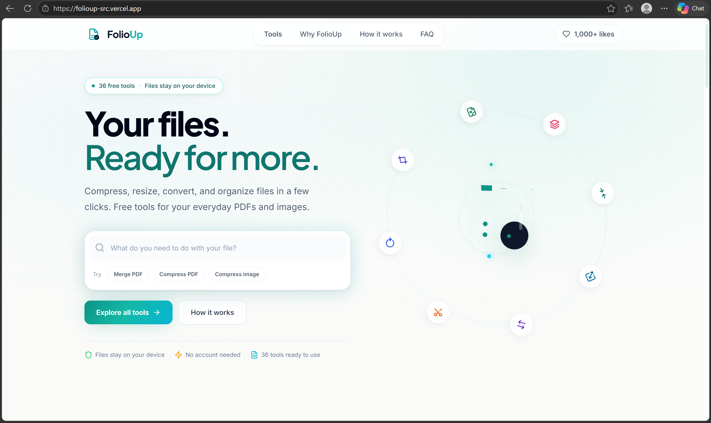

<div align="center">

# FolioUp

**Your files. Ready for more.**

Free, private PDF and image tools that run entirely in your browser.
No sign-up. No uploads. No watermarks.

[**Live demo**](https://folioup-src.vercel.app) · [Features](#features) · [How it works](#how-it-works) · [Run locally](#run-locally)



</div>

---

## Why FolioUp?

Most online PDF tools upload your documents to a server. That is a problem for anything sensitive: contracts, ID scans, bank statements, assignments.

FolioUp does the work **on your device**. Your files are opened, processed, and saved by your own browser, and they are never sent anywhere.

- **Private:** files never leave your device
- **Free:** 36 working tools, no account required
- **Fast:** no upload or download wait, since processing starts instantly
- **Clean:** no ads, no watermarks on your output

## Features

36 tools are live today, grouped by what you want to do.

| Category | Tools |
| --- | --- |
| **Organize PDFs** | Merge, split, extract pages, delete pages, reorder pages, rotate, duplicate pages, insert blank pages, reverse, crop |
| **Optimize PDFs** | Compress, optimize, flatten, remove metadata |
| **Convert to PDF** | JPG to PDF, PNG to PDF, images to PDF, text to PDF |
| **Convert from PDF** | PDF to JPG, PDF to PNG, PDF to text, PDF to Word, PDF to HTML, PDF to ZIP |
| **Edit and annotate** | Add page numbers, add watermark, add text, edit PDF, headers and footers, sign PDF |
| **Inspect** | Compare two PDFs, page counter, view metadata |
| **Images** | Compress, resize, convert format |

### Also included

- Light and dark theme
- Drag-and-drop uploads with a file list
- Searchable tool launcher on the home page
- Real progress reporting while a file is processed
- Clear error messages for invalid page ranges and unreadable files

### Roadmap

These tools are planned and shown as "coming soon" in the app: repair PDF, Word / Excel / PowerPoint / HTML to PDF, PDF to Excel, PDF to PowerPoint, protect and unlock PDF, redact, OCR, extract tables, and extract images.

## How it works

Everything runs client-side:

1. You pick or drop a file. The browser reads it into memory using the File API.
2. **[pdf-lib](https://pdf-lib.js.org/)** edits and builds PDF documents: merging, splitting, rotating, cropping, stamping text and watermarks, and writing metadata.
3. **[PDF.js](https://mozilla.github.io/pdf.js/)** renders pages to a canvas. This powers PDF to image, text extraction, and compression.
4. **[JSZip](https://stuk.github.io/jszip/)** bundles multiple outputs (for example, one image per page) into a single download.
5. The result is handed back to you as a downloadable file, created locally with a Blob URL.

There is no server involved in processing, so there is no upload step to wait for and nothing stored anywhere.

### A note on compression

Compress PDF re-renders each page at a lower resolution and rebuilds the PDF, with a choice of Basic, Medium, or Extreme levels. Because pages become images, text in a compressed file is no longer selectable. If compression cannot make a file smaller, FolioUp keeps your original and tells you, rather than reporting a savings that did not happen.

## Tech stack

| Area | Technology |
| --- | --- |
| UI | React 18, TypeScript |
| Build tool | Vite |
| Styling | Tailwind CSS |
| Animation | Framer Motion |
| Routing | React Router |
| PDF processing | pdf-lib, PDF.js |
| Archives | JSZip |
| Icons | Lucide |
| Testing | Vitest |
| Hosting | Vercel |

## Project structure

```
src/
├── components/
│   ├── tools/          # Tool page and option panels
│   ├── upload/         # Drop zone and file list
│   └── ui/             # Shared UI components
├── lib/
│   ├── processors.ts   # The processing logic for every tool
│   ├── tools.ts        # Tool definitions: name, category, options, status
│   └── pdf/            # PDF helpers: loading, rendering, page ranges
├── pages/              # Home, all tools, legal
└── main.tsx
```

Each tool is described once in `tools.ts` (its slug, category, options, and whether it is active or planned) and implemented as a function in `processors.ts`. Adding a new tool means adding an entry in both places.

## Run locally

You need [Node.js](https://nodejs.org/) 18 or newer.

```bash
git clone https://github.com/SajidKelkar/FolioUp.git
cd FolioUp
npm install
npm run dev
```

Then open the local address printed in your terminal.

### Scripts

| Command | What it does |
| --- | --- |
| `npm run dev` | Start the development server |
| `npm run build` | Create a production build |
| `npm run preview` | Preview the production build |
| `npm test` | Run the unit tests |
| `npm run lint` | Lint the code |
| `npm run typecheck` | Check TypeScript types |

## Testing

The processing logic has unit tests written with [Vitest](https://vitest.dev/), covering page-range parsing and the PDF processors. They create real PDFs in memory, run each tool on them, and check the output.

```bash
npm test
```

## Limitations

- Everything runs in your browser, so very large files are limited by your device's memory.
- Compressed PDFs lose selectable text, as described above.
- Word, Excel, and PowerPoint conversions are not available yet, because they are difficult to do accurately without a server.

## Author

**Sajid Kelkar**, Computer Engineering student building full-stack web apps.

[GitHub](https://github.com/SajidKelkar) · [LinkedIn](https://www.linkedin.com/in/sajidkelkar) · [Sova, my AI chat platform](https://github.com/SajidKelkar/sova-ai-chat-platform)
